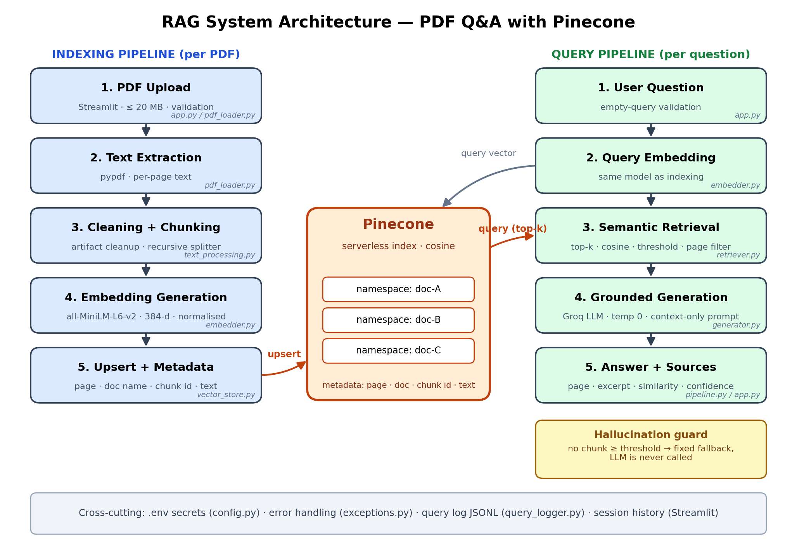

# PDF Question Answering — RAG with Pinecone

Intermediate RAG system: upload PDF(s), index them in **Pinecone**, ask questions, and get answers
**strictly grounded in the document**, with page number, excerpt and similarity score for every source.



## Features
- PDF upload (multiple files, ≤ 20 MB each), validation (empty / corrupt / encrypted / scanned PDFs)
- Cleaning (headers/footers, page numbers, hyphenation, ligatures) + page-aware recursive chunking
- `all-MiniLM-L6-v2` embeddings (384-d, normalised) → Pinecone serverless index (cosine)
- One **namespace per document**, metadata: `doc_name`, `page`, `chunk_id` (+ `chunk_index`, `chunk_size`, `text`)
- Top-k retrieval with adjustable similarity threshold and page-range metadata filter
- Groq LLM (temperature 0) with a context-only prompt; fixed fallback sentence when context is insufficient
- Source attribution: page, excerpt, similarity score, confidence label

**Intermediate enhancements implemented (7 of 7; 3 required):** multi-document support, query history,
adjustable chunk size, adjustable top-k, metadata (page) filtering, confidence scoring, query logging.

## Setup
```bash
python -m venv .venv && source .venv/bin/activate     # Windows: .venv\Scripts\activate
pip install -r requirements.txt
cp .env.example .env                                   # then add PINECONE_API_KEY and GROQ_API_KEY
streamlit run app.py
```
The index (`pdf-rag-index`) is created automatically on first run (serverless, AWS `us-east-1`).
Free keys: [Pinecone](https://app.pinecone.io) · [Groq](https://console.groq.com).

## Project structure
```
app.py                  Streamlit UI
rag/config.py           env-based settings + FALLBACK_ANSWER
rag/pdf_loader.py       PDF validation + text extraction
rag/text_processing.py  cleaning + chunking
rag/embedder.py         sentence-transformers wrapper
rag/vector_store.py     Pinecone: index, namespaces, upsert, query, delete
rag/retriever.py        embed query, search namespaces, threshold, page filter
rag/generator.py        grounded Groq generation, citation parsing
rag/pipeline.py         orchestration + confidence score
rag/query_logger.py     app log + logs/queries.jsonl
rag/exceptions.py       typed errors shown by the UI
tests/                  26 unit tests (no network needed): pytest
docs/                   architecture diagram (+ generator script)
```

## How hallucination is prevented
1. Chunks below the similarity threshold are discarded; if none remain, the LLM is **never called** and the
   fixed sentence *"The answer is not available in the provided document."* is returned.
2. The prompt allows only the numbered context, demands citations, and treats document text as untrusted.
3. Temperature 0; if the model itself answers "not available", the reply is normalised to the fixed sentence.
4. Every answer shows its source chunks so claims can be verified.

## Configuration (`.env`)
| Variable | Default |
|---|---|
| `PINECONE_API_KEY`, `GROQ_API_KEY` | required |
| `PINECONE_INDEX_NAME` | `pdf-rag-index` |
| `PINECONE_CLOUD` / `PINECONE_REGION` | `aws` / `us-east-1` |
| `GROQ_MODEL` | `llama-3.3-70b-versatile` |
| `EMBEDDING_MODEL` | `sentence-transformers/all-MiniLM-L6-v2` |
| `MAX_PDF_MB` | `20` |

## Tests
```bash
python -m pytest -q
```

## Demo checklist (5–7 min)
1. Show `.env.example`, project structure and architecture diagram (30 s)
2. Upload 1–2 PDFs → show indexing summary; open the Pinecone console: index, namespaces, vector metadata
3. Ask an answerable question → show answer, confidence, sources (page, excerpt, score)
4. Ask something not in the PDF → show the fallback sentence
5. Change chunk size / top-k / threshold, re-index, compare; use the page filter
6. Multi-document question; show query history; show `logs/queries.jsonl`
7. Error cases: empty question, non-PDF upload
